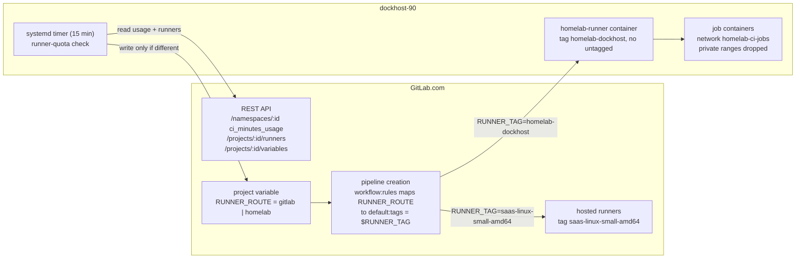

# Role gitlab_runner — hybrid CI with a quota fallback

GitLab.com hosted runners run the homelab pipelines by default. When the
monthly compute quota of the `tipunchlabs` namespace gets close to its limit,
new pipelines go to a project runner on dockhost-90, until GitLab.com renews
the quota. The role installs that runner, an egress filter for its jobs, and
the `runner-quota` controller that decides the route.

## Why

The Free tier gives 400 compute minutes a month to the whole namespace
(October 2026: 314 used). Past the limit, GitLab.com stops running jobs and
the merge gate (`only_allow_merge_if_pipeline_succeeds`) blocks every MR. The
homelab runner keeps pipelines running without using dockhost the rest of the
time.

## Architecture



| Part | Where | Managed by |
|---|---|---|
| Runner object (tags, untagged=false, locked) | GitLab project runner | `gitlab-terraform` `gitlab_user_runner.homelab` |
| `RUNNER_ROUTE` variable | project CI/CD variable | `runner-quota` (not Terraform, on purpose: it changes every month) |
| Routing map | `.gitlab-ci.yml` `workflow:rules` + `default:tags` | Git |
| Runner manager, job network, egress filter | dockhost-90 | this role |
| Controller, timer, state | dockhost-90 `/opt/runner-quota`, `/var/lib/runner-quota` | this role |

### Routing

`.gitlab-ci.yml` sets `RUNNER_TAG=saas-linux-small-amd64`, and the workflow
rule switches it to `homelab-dockhost` only when `RUNNER_ROUTE == "homelab"`.
Any other value, or no variable, means GitLab.com. The tag is resolved once,
when the pipeline is created:

- Jobs already created keep their runner. A pipeline created on GitLab.com
  before the switch stays on GitLab.com, retries included.
- To move it, run a new pipeline (CI/CD > Pipelines > Run pipeline, or push).
  To force the route, whatever the quota says, use
  `runner-quota set-mode homelab|gitlab` (then `set-mode auto`). Pipeline
  variables cannot be used: this project sets
  `ci_pipeline_variables_minimum_override_role = no_one_allowed`.
- Forks have no `RUNNER_ROUTE` and no access to the project runner: they
  always use GitLab.com.
- Never define `RUNNER_TAG` as a project or group variable: it would take
  precedence over the map.

Verify which runner a pipeline uses: job page, "Runner" field, or
`glab api projects/80082616/jobs/<id> | jq .runner.description`.

### Runner isolation

| Control | Setting |
|---|---|
| Executor | Docker, `privileged = false`, `cap_drop = NET_RAW`, `no-new-privileges` |
| Docker socket | mounted in the runner manager only (needed to start jobs), never in jobs (`volumes = ["/cache"]`) |
| Network | jobs on `homelab-ci-jobs` (172.31.250.0/24, ICC disabled: concurrent jobs cannot reach each other). `homelab-ci-egress` drops every packet from that subnet to 10/8, 172.16/12, 192.168/16, 100.64/10, 169.254/16 (DOCKER-USER) and to dockhost itself (INPUT), with no connection-state exception. Jobs reach the Internet only |
| Resources | `concurrent = 2`, 1.5 CPU and 2.5 GB per job |
| Scope | project runner of tipunchlabs/homelab only, `locked`, tagged jobs only |
| Secrets | jobs only see the project CI variables (`RENOVATE_TOKEN`, same as on GitLab.com). No vault, Terraform or Komodo credential is on the job network |

The runner fails closed: `homelab-runner.service` owns the container
(`docker compose up` in the foreground, no Docker restart policy) and
`Requires=` `homelab-ci-egress.service`; it also reapplies the filter in
`ExecStartPre`. If the filter cannot be installed, the runner does not start
and the other dockhost services are not affected. The filter is replaced
atomically (`iptables-restore --noflush`), so reapplying it never opens a
window. Docker keeps the `DOCKER-USER` content and only adds its own jump.

## The controller

`runner-quota` (`files/runner_quota.py`, Python stdlib only) runs every
15 minutes from `runner-quota.timer`, as the `runner-quota` system user.

### Data sources

| Value | Source | Notes |
|---|---|---|
| Minutes used this month | `GET /namespaces/125854366` → `ci_minutes_usage.monthly_minutes_used` | Owner role required; includes the cost factor |
| Monthly limit | `runner_quota_monthly_limit_minutes` (400) | `shared_runners_minutes_limit` is visible to GitLab.com admins only. The limit is the documented Free tier allowance, and the controller trusts it only while `plan == "free"`; any other plan stops automation (route kept, alert) |
| Homelab runner | `GET /projects/80082616/runners?type=project_type&tag_list=homelab-dockhost` | exactly one, online, not paused |
| GitLab.com runners | `GET /projects/80082616/runners?type=instance_type&tag_list=saas-linux-small-amd64` | at least one online |
| Current route | `GET /projects/80082616/variables/RUNNER_ROUTE` | must be unprotected, `env_var`, scope `*` |

### Policy (AUTO)

1. Usage below the threshold (85 %) → `gitlab`.
2. Usage at or above the threshold, and the homelab runner online → `homelab`,
   and the month is latched (`state.json`: month, minutes used).
3. Threshold reached but the homelab runner offline → no switch, alert.
4. While latched, the route stays `homelab`, even if the API reports a lower
   value in the same month. The latch is released only when the reported
   usage is below the latched value **and** below the threshold **and** a
   GitLab.com runner is online, **and** either the month changed since the
   latch, or the latch was taken on day 1-2 of the month (possibly on the
   previous month's value, not yet reset) and usage fell below half the
   threshold, as a real reset does. A date change alone never returns to
   GitLab.com.
5. The latch is saved before `RUNNER_ROUTE` is written: a crash or a failed
   write never loses it, and the next run retries the write.
6. Any API error, incomplete answer, unexpected plan or unreadable variable →
   route kept as it is, alert.
7. The variable is written only when its value differs, then read back.
   Each API call is tried twice (15 s timeout); a run stays under the
   300 s systemd limit.

A latch records the limit it was taken with. If
`runner_quota_monthly_limit_minutes` changes afterwards, the latch is never
released automatically, even in a later month (a new denominator is not
evidence of a reset): the route stays `homelab` with an alert until
`set-mode auto --clear-latch`. When returning to GitLab.com, the latch is
dropped only after `RUNNER_ROUTE=gitlab` is written and read back; a failed or
interrupted return is re-evaluated in full (renewal and GitLab.com runners)
on the next run.

### Modes

| Mode | Effect | Reversible with |
|---|---|---|
| `auto` | policy above | — |
| `gitlab` | force GitLab.com, even past the threshold | `set-mode auto` |
| `homelab` | force dockhost, even if the runner looks offline (alert) | `set-mode auto` |

The mode is stored in `/var/lib/runner-quota/state.json`, so it survives
restarts. A bad configuration (threshold out of range, limit ≤ 0, equal tags)
makes every run exit with code 2 and change nothing: it cannot flap.

### Commands (on dockhost-90, sudo)

```bash
runner-quota status                          # quota, %, threshold, mode, route, runners, last check (read-only)
runner-quota check --dry-run                 # evaluate, write nothing
runner-quota check --simulate-used 340       # pretend 340 min used (implies --dry-run)
runner-quota check --simulate-used 3 --simulate-month 2026-12
runner-quota set-mode homelab                # force dockhost now
runner-quota set-mode gitlab                 # force GitLab.com now
runner-quota set-mode auto                   # back to the policy (keeps the latch)
runner-quota set-mode auto --clear-latch     # forget this month's latch
```

Exit codes: 0 ok, 1 alert (unit marked failed), 2 configuration error.

### Errors and alerts

```bash
systemctl list-timers runner-quota.timer
systemctl status runner-quota.service        # "failed" = last run raised an alert
journalctl -u runner-quota.service -n 20     # one JSON line per run
```

There is no push alerting in the homelab yet: a failed `runner-quota.service`
is the alert.

### Disable

```bash
runner-quota set-mode gitlab                 # route back to GitLab.com
systemctl disable --now runner-quota.timer
```

Durably: set `runner_quota_enabled: false` and rerun the role; it stops and
disables the timer but leaves `RUNNER_ROUTE` as it is (set it first).

Deleting `RUNNER_ROUTE` also sends every new pipeline to GitLab.com.

## Failure scenarios

| Situation | Behaviour | Action |
|---|---|---|
| GitLab.com API down | route kept, alert | none; next run retries |
| GitLab.com runners down, quota fine | route stays `gitlab`, pipelines wait | `set-mode homelab`, then `set-mode auto` once GitLab.com is back |
| dockhost down, route `gitlab` | nothing changes | none |
| dockhost down, route `homelab` | new jobs stay pending; the controller is down with it | start dockhost; or `glab api -X PUT projects/80082616/variables/RUNNER_ROUTE -f value=gitlab` from the workstation if minutes remain |
| Quota exhausted and homelab runner down | no runner can take the jobs: pipelines stay pending, MRs cannot merge | restore the runner (`ansible-playbook ansible/deploy.yml --tags gitlab-runner`), then run a new pipeline. Buying minutes is the only other way out |
| Runner token revoked (403 in `docker logs homelab-runner`) | runner offline, the controller refuses to switch to it | recreate the runner (below) |
| Egress filter cannot be installed | `homelab-runner.service` does not start (fail closed) | `systemctl status homelab-ci-egress`, fix, `systemctl start homelab-runner` |

## Credentials

| Secret | Holder | Rotation |
|---|---|---|
| Runner token `glrt-` | `vault_gitlab_runner_token`, `/opt/homelab-runner/config/config.toml` (0600 root) | `terraform apply -replace=gitlab_user_runner.homelab` in gitlab-terraform, then update the vault and rerun the role |
| runner-quota token | `vault_runner_quota_token`, `/etc/runner-quota/token` (0640 root:runner-quota) | create a new fine-grained PAT, `ansible-vault edit`, rerun the role, revoke the old one |

The runner-quota token is a **fine-grained personal access token** (GA in
GitLab 19.2, Free tier; project and group access tokens need Premium on
GitLab.com). Permissions:

- Namespace: Read (User access): `GET /namespaces/:id`
- Variable: Read, Update, on project tipunchlabs/homelab
- Runner: Read, on project tipunchlabs/homelab

No Create permission: the variable is created once by the owner (runbook).

## Deployment runbook

Every mutating step needs the owner GO. Steps 2, 4, 6, 9 run from an owner
terminal (pass, vault, Terraform credentials).

1. Preflight (read-only): dockhost free memory > 6 GB and disk > 20 GB,
   `docker info` firewall backend `iptables`, no network on 172.31.250.0/24.
2. Runner object: in `gitlab-terraform`, `scripts/with-secrets gitlab --
   terraform plan -out=<dir>/runner.tfplan` must show **1 to add**
   (`gitlab_user_runner.homelab`) and nothing else; then `terraform apply
   <dir>/runner.tfplan`.
3. Token: create the fine-grained PAT above (Settings > Access tokens >
   Fine-grained, expiry ≤ 1 year).
4. Vault: `scripts/gitlab-runner-vault.sh` (reads the runner token from
   Terraform, prompts for the PAT). Commit the encrypted file on a branch.
5. Variable (once):
   `glab api -X POST projects/80082616/variables -f key=RUNNER_ROUTE -f value=gitlab -f protected=false -f masked=false -f environment_scope='*'`
6. Runner: `cd dockhost && ansible-playbook ansible/deploy.yml --tags gitlab-runner -e runner_quota_enabled=false`
   (controller still disabled; `group_vars` now enables it by default). Check the runner is online
   (`glab api 'projects/80082616/runners?type=project_type'`) and
   `systemctl is-active homelab-ci-egress homelab-runner`.
7. Isolation and test job:
   - `docker run --rm --network homelab-ci-jobs alpine:3.24 wget -qT5 -O- https://gitlab.com >/dev/null` succeeds;
   - the same against `http://192.168.10.100:8006`, `http://192.168.10.90:9120`
     and `http://192.168.10.71` fails;
   - two containers on `homelab-ci-jobs` cannot reach each other (ICC);
   - the other dockhost services still answer (kandidat, Komodo UI, Excalidraw);
   - on a test branch pushed with `git push -o ci.skip`, set `RUNNER_ROUTE=homelab`,
     create one pipeline (`glab api -X POST 'projects/80082616/pipeline?ref=<branch>'`),
     set `RUNNER_ROUTE=gitlab` back at once: every job must run on
     `homelab-dockhost-90` and pass. Pipeline variables are disabled here.
8. Old runner: `docker compose -f /opt/gitlab-runner/docker-compose.yml down`
   (it has been unregistered since bastion-60: 403 on every poll). Keep
   `/opt/gitlab-runner` until the new runner has run for a month.
9. Controller: `ansible-playbook ansible/deploy.yml --tags gitlab-runner -e runner_quota_enabled=true`
   (the role runs `runner-quota check --dry-run` before enabling the timer),
   then set `runner_quota_enabled: true` in `group_vars/dockhost/all/main.yml`.
10. Simulations: `runner-quota check --simulate-used 340` → would set
    `homelab`; `--simulate-used 336` → `gitlab`.
11. Real switch: `runner-quota set-mode homelab`, push or Run pipeline → jobs
    on dockhost; `runner-quota set-mode auto` → `RUNNER_ROUTE=gitlab` when usage
    is below the threshold and no latch is active (otherwise it stays on
    homelab; `set-mode gitlab` forces the return), next pipeline on GitLab.com.
12. Watch: `systemctl list-timers runner-quota.timer`, `journalctl -u runner-quota`.

### Deployment status

Deployed on 2026-11-05: runner 58580750 (`gitlab_user_runner.homelab`), runner
v19.5.2, controller timer enabled, mode AUTO. The old `gitlab_runner`
container was removed with `docker compose down`; `/opt/gitlab-runner` and
its volumes are kept until 2026-12-05. Docker loads `br_netfilter` itself
for the `enable_icc=false` network (bridge traffic then goes through
iptables), which is expected.

### Rollback

Pipelines keep running at every step: GitLab.com stays the default route.

1. `runner-quota set-mode gitlab` (or set `RUNNER_ROUTE=gitlab` with glab).
2. `systemctl disable --now runner-quota.timer`.
3. `systemctl disable --now homelab-runner.service` (stops the container).
4. `systemctl disable --now homelab-ci-egress.service`, then
   `iptables -D DOCKER-USER -s 172.31.250.0/24 -j HOMELAB-CI-EGRESS` and
   `iptables -D INPUT -s 172.31.250.0/24 -j HOMELAB-CI-INPUT`.
5. Revert the `.gitlab-ci.yml` routing block if needed (jobs untagged again).
